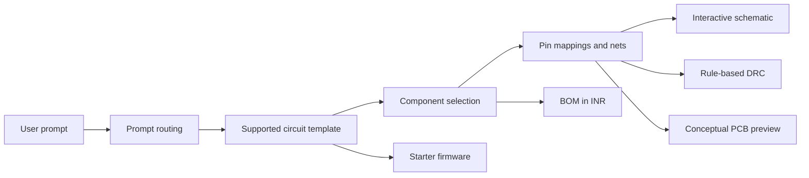

# AutoCircuit AI

AutoCircuit AI is a React and TypeScript prototype for converting a natural-language electronics requirement into a structured starting design. It connects the same generated design data across the schematic, pin mapping, DRC report, BOM, firmware, and conceptual PCB preview.

**Live demo:** https://auto-circuit-ai.vercel.app/  
**Repository:** https://github.com/mahadev-minajigi/AutoCircuitAI.git

## Project Goal

Early hardware design often requires switching between datasheets, pin tables, wiring notes, firmware, and parts lists. AutoCircuit AI demonstrates a beginner-friendly workflow that produces these outputs from one requirement and keeps them consistent for an initial prototype review.

This is an educational proof of concept, not a replacement for KiCad, Altium, SPICE, or a manufacturing-ready EDA flow.

## System Workflow



## Current Features

- Natural-language design prompt with a Quick Start weather-station preset
- Shared design model used by every result view
- Interactive schematic with visible power, ground, I2C, SPI, and other signal nets
- Interactive Three.js 3D + time circuit view with orbit, pan, zoom, component selection, and a scrub-able playback timeline for supported firmware outputs
- MCU-to-component pin mapping table
- Rule-based DRC checks for MCU selection, voltage compatibility, current demand, and I2C notes
- BOM with estimated costs displayed in Indian rupees (INR)
- CSV, JSON, and firmware export from the header
- Starter firmware examples for supported templates
- Advisory prompt-coverage warnings for explicitly requested boards, named parts, interfaces, pins, and selected firmware behaviors not evident in the generated design
- A limited firmware-driven visual model for straight-line `digitalWrite(HIGH/LOW)` and `delay()` calls in `loop()`, with mapped LED and GPIO state reflected in the 3D circuit and breadboard timeline; playback/scrubbing does not claim to be an electrical simulation
- Design-specific conceptual PCB placement preview
- Responsive layout with page scrolling and mobile stacking

## Demo 1: IoT Weather Station

Use the Quick Start card or enter:

```text
Design a temperature, humidity and pressure monitoring system using ESP32, BME280 and OLED display.
```

The generated design contains:

- ESP32-WROOM-32
- BME280 environmental sensor
- SSD1306 OLED display
- 3.3V and common GND connections
- Shared I2C SDA and SCL connections
- Starter Arduino firmware
- BOM, DRC report, pin mapping, and PCB preview

## Demo 2: STM32 SPI Flight Controller

To test the separate SPI signal routes, enter:

```text
Design an STM32F405 flight controller using an MPU6000 6-axis IMU connected through SPI1.

Use:
- STM32F405 as the main MCU
- MPU6000 as the motion sensor
- 3.3V power
- Common GND

SPI1 connections:
- PA5 (SPI1_SCK) -> MPU6000 SCLK
- PA6 (SPI1_MISO) -> MPU6000 MISO
- PA7 (SPI1_MOSI) -> MPU6000 MOSI
- PA4 (SPI1_NSS/CS) -> MPU6000 CS
```

The schematic should show four separate SPI routes: SCK, MISO, MOSI, and CS. The STM32 example intentionally excludes an unused floating regulator block.

## How Prompt Routing Works

Typed custom prompts use the configured Gemini service before keyword-based local routing, except for supported curated circuit patterns, which are selected first for predictable results. If Gemini returns an invalid design or the configured backend fails, the backend returns a clearly marked local fallback instead of leaving the user without a design; this fallback may not match the prompt and must be reviewed. If the backend cannot be reached, the browser may also load a marked local fallback. Without a Gemini key, the backend uses local examples for supported prompt types. Quick-start preset cards intentionally load their fixed example designs:

- Prompts containing `stm32`, `drone`, or `flight` use the STM32F405 flight-controller template.
- Prompts containing `pico`, `rp2040`, `synth`, or `audio` use the RP2040 audio template.
- Weather, BME280, temperature, humidity, pressure, or OLED prompts use the ESP32 weather-station template.
- Arduino Uno pushbutton/LED prompts use the button-and-LED circuit; Arduino Uno blink/LED prompts use a dedicated LED circuit.
- ATmega328P LED-and-button prompts use a standalone 5V DIP circuit with a crystal, reset pull-up, button input, and current-limited LED output.
- Arduino Uno motor prompts use the motor-controller template.

The IDE uses the returned design as its single source for the circuit visualization, component list, pin mapping, DRC results, and firmware editor. If a prompt does not match a supported template and Gemini is unavailable, the app marks the chosen template as a starting point instead of presenting it as a prompt-matched circuit. Unsupported firmware is labeled as not simulated in the 3D and breadboard previews rather than presenting guessed activity. Always verify a generated design before building hardware.

## Project Structure

```text
src/
├── App.tsx                         Main workflow and tab navigation
├── components/
│   ├── PromptStudio.tsx             Prompt input and Quick Start
│   ├── Circuit3DViewer.tsx          Interactive 3D circuit and live output preview
│   ├── SchematicViewer.tsx          React Flow circuit diagram
│   ├── PinoutTable.tsx              MCU-to-component mappings
│   ├── DrcReport.tsx                Rule-based electrical checks
│   ├── BomTable.tsx                 INR bill of materials
│   ├── CodeEditor.tsx               Starter firmware view
│   └── PcbViewer.tsx                Conceptual design-specific PCB preview
├── data/circuitTemplates.ts         Supported circuit templates
├── services/aiCircuitEngine.ts      Template routing and DRC generation
└── types/circuit.ts                 Shared TypeScript data model
```

## Tech Stack

- React 19
- TypeScript
- Vite
- React Flow
- Lucide React
- HTML Canvas for the conceptual PCB preview
- CSS responsive layout

## Run Locally

Install the frontend and Python backend dependencies once:

```bash
npm install
python -m pip install -r requirements.txt
```

Start both services together:

```bash
npm run dev:full
```

Open the Vite URL shown in the terminal. The frontend runs on Vite and proxies `/api` requests to FastAPI on `http://127.0.0.1:8000`. Check backend availability at `http://127.0.0.1:8000/api/health`. To use Gemini locally, put `GEMINI_API_KEY=...` in the ignored `.env` file; template generation still works without a key.

For local firmware compilation, install [Arduino CLI](https://docs.arduino.cc/arduino-cli/installation/) for Windows and make sure its installation folder is on `PATH`. Close and reopen PowerShell after installing it, then verify `arduino-cli version`. Install the board cores used by the selected target:

```powershell
arduino-cli core update-index
arduino-cli core install arduino:avr
arduino-cli core install esp32:esp32
arduino-cli core install rp2040:rp2040
```

Install sketch libraries with `arduino-cli lib install "Adafruit BME280 Library" "Adafruit Unified Sensor" "Adafruit GFX Library" "Adafruit SSD1306"`. Keep `npm run dev:full` running; the IDE Compile action then sends the sketch to this local compiler. The public serverless deployment may report compilation unavailable if Arduino CLI or its board core is not installed there; it never claims an unrun compile succeeded.

Alternatively, run `npm run dev` and `npm run dev:backend` in separate terminals.

## Build and Validate

```bash
npm run build
```

The production build runs TypeScript project checks followed by the Vite production bundle.

## Limitations

- The current generator uses local templates and keyword routing; it is not yet a general-purpose AI circuit synthesizer.
- DRC is rule-based and intentionally limited to prototype-level checks.
- The visual firmware model is not a C++ interpreter or electrical simulator. It only models straight-line `digitalWrite(HIGH/LOW)` and literal `delay(milliseconds)` statements in `loop()`; conditionals, input state, PWM, sensor behavior, and other firmware are reported as not simulated rather than guessed. The unsupported waveform panel has been removed; supported output playback is shown on the 3D circuit and breadboard timelines.
- The PCB view is a conceptual placement preview, not a real netlist, autorouter, Gerber generator, or manufacturing layout.
- Component prices are illustrative INR estimates, not live distributor prices.
- Pin mappings should be checked against the target board, module datasheet, voltage requirements, pull-ups, decoupling, and current limits before building hardware.

## Future Improvements

Planned improvements, in priority order:

1. **Structured AI generation:** connect an LLM backend that converts requirements into a validated circuit schema instead of keyword-based template selection.
2. **Datasheet-aware validation:** add verified pin, voltage, current, address, package, and interface constraints from component libraries and datasheets.
3. **Complete electrical rules:** validate unconnected pins, power trees, pull-ups, decoupling capacitors, level shifting, current margins, and conflicting bus addresses.
4. **Real schematic export:** export standards-based KiCad schematic/netlist files for continued engineering work.
5. **Manufacturing-ready PCB flow:** add footprint assignment, board constraints, real routing, design-rule checks, and Gerber/Drill export.
6. **Better design interaction:** support editable components, manual wire changes, undo/redo, and regeneration of only the affected subsystem.
7. **Testing and collaboration:** add automated fixture tests for prompt-to-template routing, visual regression tests, saved projects, authentication, and shareable design links.
8. **Live component sourcing:** connect distributor APIs for current INR pricing, stock, alternatives, and total-cost comparison.

## Project Status

This is a first-review prototype. Its strongest demonstrated flow is the ESP32 weather station, with the STM32/MPU6000 example serving as a secondary SPI validation case. The project prioritizes a clear, consistent end-to-end demonstration while documenting the engineering work still required for a professional EDA product.
